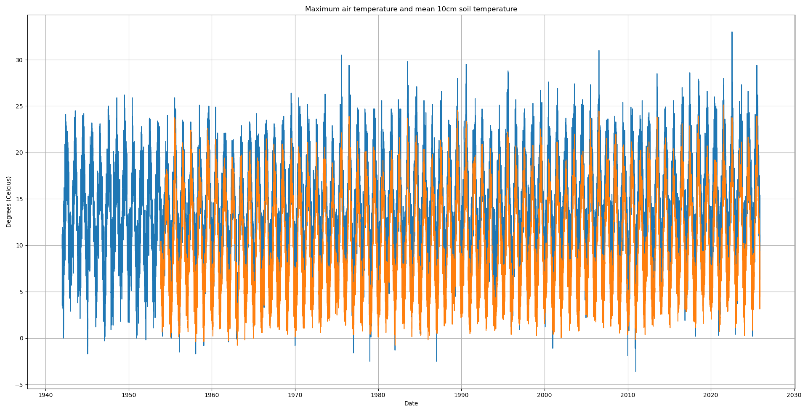

# Dublin Temperature Trend Analysis
An analysis of daily temperature data from six weather stations around Dublin, sourced from https://data.gov.ie.

# What it does
- `loader.py` script reads each CSV file, and handles missing fields, duplicate rows and converts dates to YYYY-MM-DD. 

- This cleaned data is then uplodaded to a SQLite database.

- `createAvg.py` then averages the values into one table.

- Then the data is graphed in the `insight` scripts and the graphs saved in the visualisations folder.

- Conclusions are drawn from these graphs in the [DPCA_Report](docs/DPCA_Report.pdf) file in the docs folder.



# How to run

From the repository root

```cmd
    pip install pandas numpy matplotlib scipy
    python loader.py
    python insight.py
    python insight2.py
    python insight3.py
    python insight4.py
```
The visualisations included in the report should now be visible in the visualitions folder.

# Background
Built for the Data Programming module's continuous assessment, graded 88%.